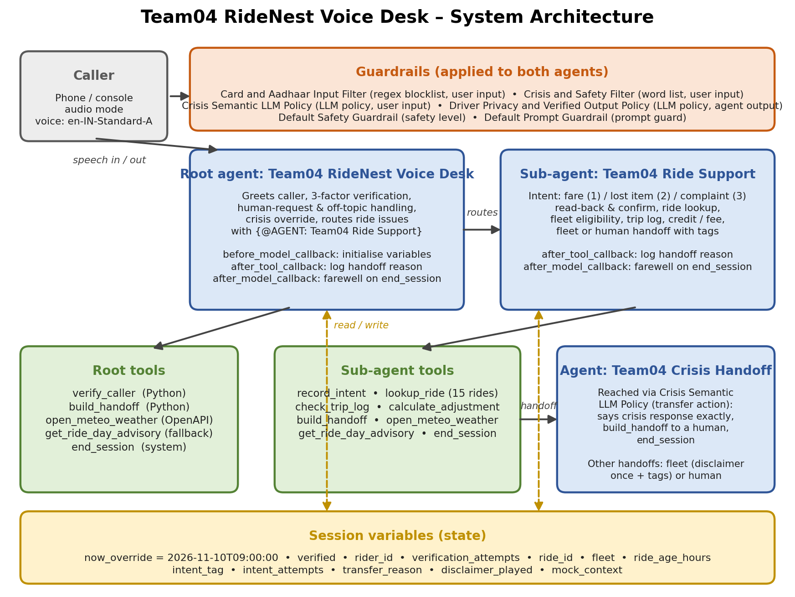
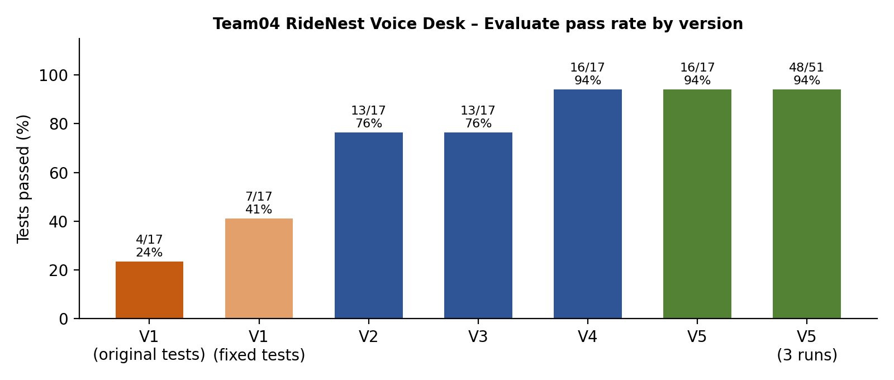

# RideNest Voice Desk — AI Ride-Support Voice Agent

Capstone project (Team 04, SRM Institute of Science and Technology, November 2026).

RideNest is a fictional ride-hailing service whose riders phone a support desk to dispute a fare, report a lost item or complain about a driver. This repository contains the exported voice agent, built in **Google CX Agent Studio** with Gemini, together with its tools, guardrails and evaluation suite.



## What it does

- **3 agents:** a root voice desk that greets and verifies callers, a Ride Support sub-agent that handles the request, and a Crisis Handoff safety agent.
- **7 deterministic Python tools:** `verify_caller`, `record_intent`, `lookup_ride`, `check_trip_log`, `calculate_adjustment`, `build_handoff`, `get_ride_day_advisory`, plus an **OpenAPI toolset** for the Open-Meteo weather API.
- **6 guardrails:** card and Aadhaar input filter, crisis keyword filter, crisis semantic LLM policy, driver privacy and verified-output policy, and the default prompt and safety guardrails.
- **3 callbacks** and **12 session variables** carry state between turns and agents.

Every rule that produces a number or a routing decision lives in Python, not in the prompt. This covers three-factor caller verification with retries, date-based fleet eligibility, trip-log checks, the 24 / 72 / 168-hour credit and pickup-fee tiers with half-up rounding, duplicate-credit protection, and transfer tagging. Results are therefore deterministic and testable.

## Requirements and testing

- 11 user stories, 49 edge cases and 41 test-data rows, written before the build.
- **17 evaluation tests** (11 golden, 6 scenario) in `agent/Team04_RideNest_Voice_Desk/evaluations/`, run on 5 saved versions.

| Version | Result |
|---|---|
| First build | 4 / 17 passed (24%) |
| Final build (V5) | 16 / 17 in a single run, **48 / 51 (94%) over 3 repeated runs** |



Failure analysis separated wrong tests from real agent bugs. The most important bug: a caller in crisis heard "I'm connecting you with a person now" but was never transferred. V5 fixes this with a guardrail that hands the call to the dedicated crisis agent.

## Repository layout

```
agent/Team04_RideNest_Voice_Desk/
  agents/        root agent, Ride Support sub-agent, Crisis Handoff agent (instructions + callbacks)
  tools/         7 Python tools, each with its function and a tool-fake config for stable tests
  guardrails/    6 guardrail definitions
  evaluations/   17 golden and scenario tests
figures/         architecture, pass rates and CX Agent Studio screenshots
```

To run it, import `agent/Team04_RideNest_Voice_Desk` into Google CX Agent Studio.

## Team roles

| Area | Responsibilities |
|---|---|
| Tools and data (Akshansh Sharma) | Python tools, mock riders and rides, OpenAPI toolset, callbacks, evaluation runs |
| Requirements and agent design | User stories, edge cases, test data, agent instructions, variables |
| Safety | Guardrails, crisis agent, guardrail tests |
| Evaluation and voice | Evaluation suite, failure analysis, spoken calls, report |

All riders, rides and money amounts are fictional.
